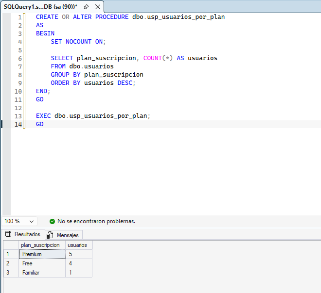
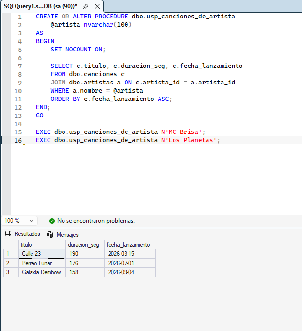
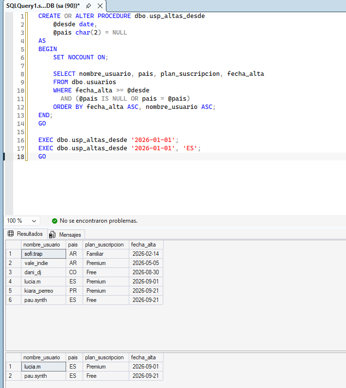
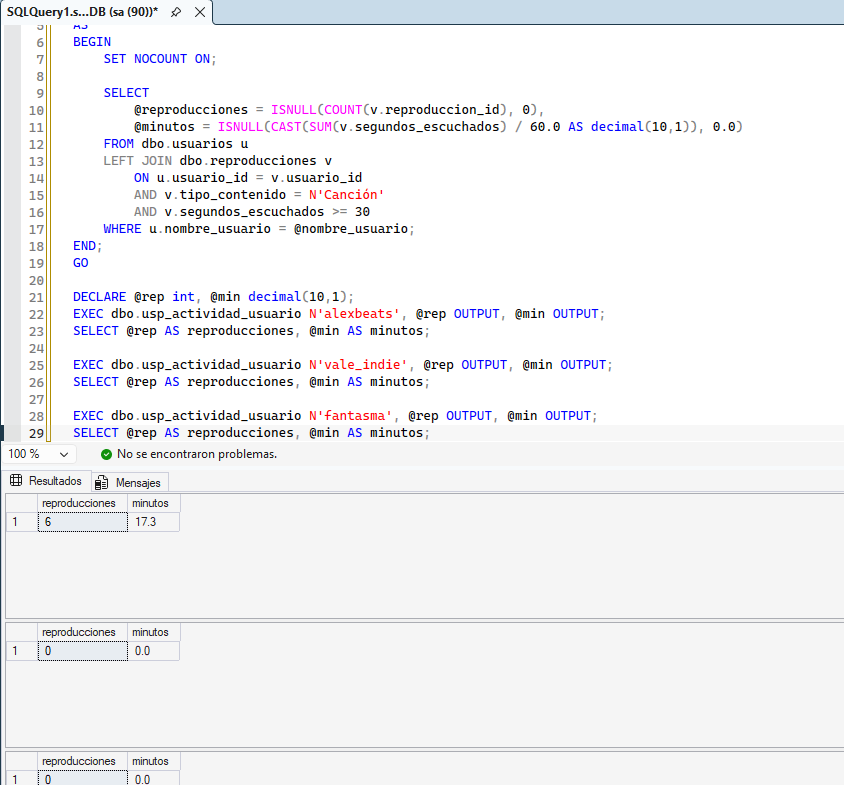
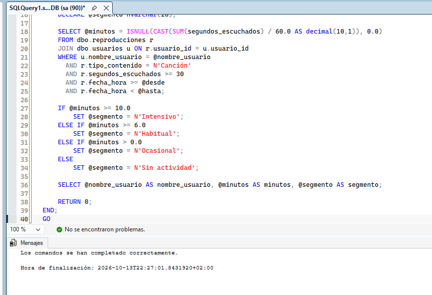
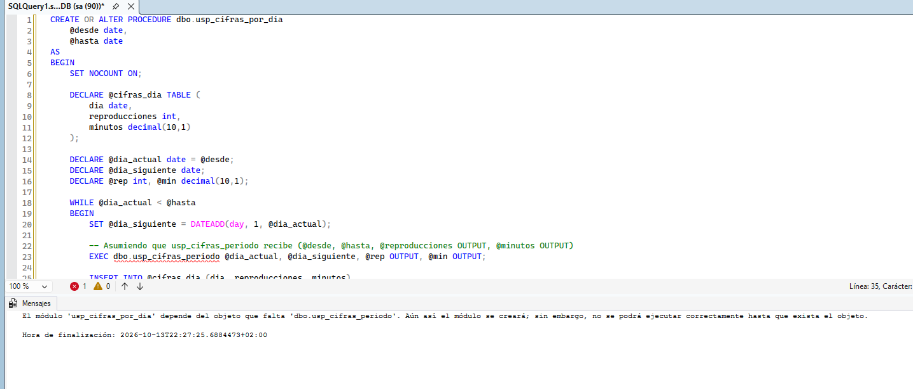
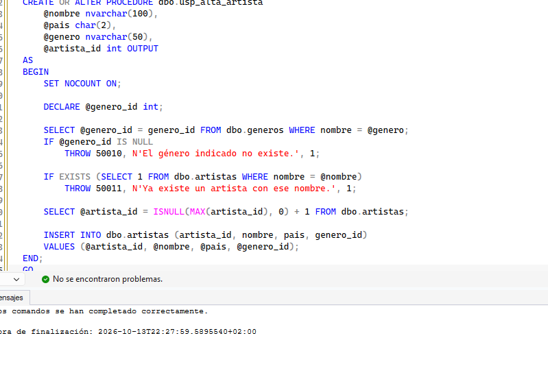
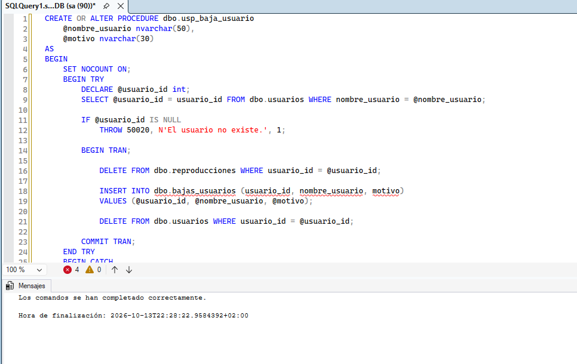
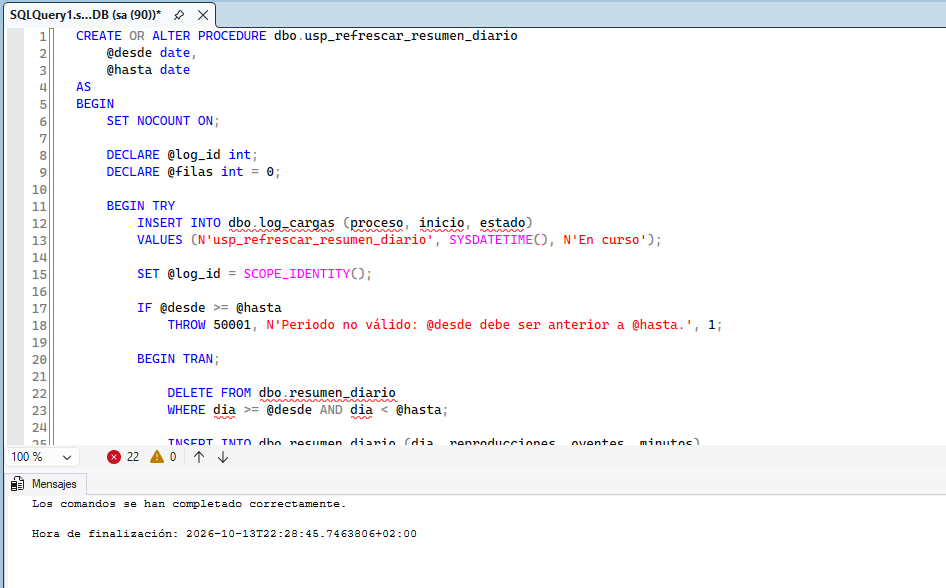
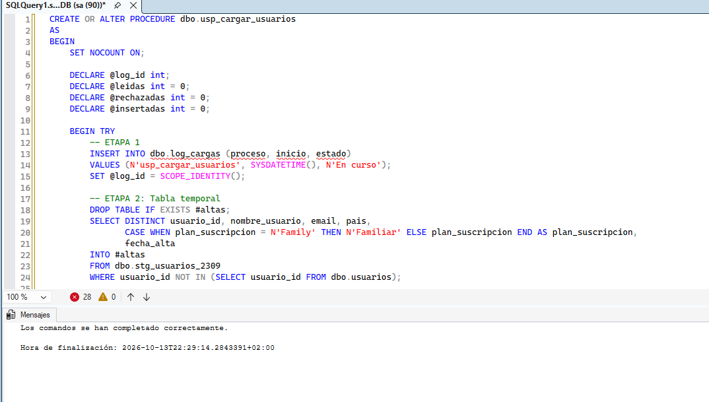

# Ejercicios de Procedimientos Almacenados en SQL

Este repositorio contiene una serie de ejercicios prácticos para el equipo de análisis de la plataforma musical Sonora, enfocados en la creación y modificación de procedimientos almacenados, control de flujo, manejo de errores y transacciones.

## Ejercicio 1
Finanzas pregunta cada pocos días cuántos usuarios hay en cada plan. Crea el procedimiento `dbo.usp_usuarios_por_plan`, sin parámetros, que devuelva el plan y el número de usuarios, ordenado de más a menos. Ejecútalo.
**Salida esperada:**
| plan_suscripcion | usuarios |
| :--- | :--- |
| Premium | 5 |
| Free | 4 |
| Familiar | 1 |

## Ejercicio 2
El equipo de relación con sellos consulta a menudo el catálogo de un artista concreto. Crea `dbo.usp_canciones_de_artista`, que reciba el nombre del artista y devuelva el título, la duración en segundos y la fecha de lanzamiento de sus canciones, ordenadas por fecha de lanzamiento. Ejecútalo para MC Brisa.
Después ejecútalo para Los Planetas, que no está en el catálogo. ¿Qué devuelve? ¿Es fácil distinguir, desde fuera, entre "el artista no existe" y "el artista existe y no tiene canciones"?
**Salida esperada para MC Brisa:**
| titulo | duracion_seg | fecha_lanzamiento |
| :--- | :--- | :--- |
| Calle 23 | 190 | 2026-03-15 |
| Perreo Lunar | 176 | 2026-07-01 |
| Galaxia Dembow | 158 | 2026-09-04 |

## Ejercicio 3
Sin ejecutarlas, indica qué ocurre con cada una de estas cinco llamadas al procedimiento `dbo.usp_top_canciones` tal como quedó en el Ejemplo 4 (parámetros `@desde`, `@hasta`, `@top = 3` y `@plan = NULL`, en ese orden). Después ejecútalas de una en una para comprobarlo.
RESPUESTAS TEÓRICAS Y EJECUCIÓN:
a) ERROR. Faltan parámetros obligatorios. El procedimiento espera al menos @desde y @hasta.
b) OK. Devuelve 2 filas. Se le pasan los parámetros por nombre (nombrados), por lo que el orden no importa.
c) ERROR. Se están pasando 3 parámetros posicionales, pero el tercero en la firma original es @top (que espera un INT), y se le está pasando 'Free' (varchar).
d) ERROR. Al mezclar parámetros nombrados y posicionales, todos los parámetros después de un nombrado también deben ser nombrados.
e) CERO FILAS. Las fechas están al revés (desde es mayor que hasta), pero sintácticamente es correcto, por lo que no da error, solo no encuentra datos.
*/
## Ejercicio 4
Marketing prepara campañas de bienvenida. Crea `dbo.usp_altas_desde`, con un parámetro obligatorio `@desde` (fecha) y un parámetro opcional `@pais` que, si no se indica, no filtra. Devuelve el nombre de usuario, el país, el plan y la fecha de alta de los usuarios dados de alta desde esa fecha, ordenados por fecha de alta y nombre de usuario.
**Salida esperada sin país:**
| nombre_usuario | pais | plan_suscripcion | fecha_alta |
| :--- | :--- | :--- | :--- |
| sofi.trap | AR | Familiar | 2026-02-14 |
| vale_indie | AR | Premium | 2026-05-05 |
| dani_dj | CO | Free | 2026-08-30 |
| lucia.m | ES | Premium | 2026-09-01 |
| kiara_perreo | PR | Premium | 2026-09-21 |
| pau.synth | ES | Free | 2026-09-21 |

## Ejercicio 5
El equipo de atención al cliente necesita las cifras de actividad de un usuario. Crea `dbo.usp_actividad_usuario`, que reciba el nombre de usuario y devuelva, en dos parámetros de salida, sus reproducciones válidas del histórico y sus minutos con un decimal.
**Salida esperada para alexbeats:**
| reproducciones | minutos |
| :--- | :--- |
| 6 | 17.3 |

## Ejercicio 6
Marketing quiere saber en qué segmento cae un usuario en un periodo. Crea `dbo.usp_segmento_usuario`, con los parámetros `@nombre_usuario`, `@desde` y `@hasta`. Retorna código 1 si no existe, o 0 si existe, y asigna un segmento (Intensivo, Habitual, Ocasional, Sin actividad) según sus minutos.

## Ejercicio 7
Producto quiere una tabla con las cifras de cada día de un periodo. Crea `dbo.usp_cifras_por_dia`, que recorra el periodo día a día con un `WHILE`. En cada vuelta debe llamar a `dbo.usp_cifras_periodo` para ese día, recoger sus parámetros de salida y guardarlos en una variable de tabla. Devuelve la tabla ordenada por día.
**Salida esperada:**
| dia | reproducciones | minutos |
| :--- | :--- | :--- |
| 2026-09-20 | 3 | 10.4 |
| 2026-09-21 | 3 | 10.9 |
| 2026-09-22 | 2 | 8.9 |
| 2026-09-23 | 0 | 0.0 |
| 2026-09-24 | 0 | 0.0 |

## Ejercicio 8
Sin ejecutarlo, indica qué filas devuelve el SELECT final de este script. Responde además: ¿qué cambia si se añade una línea con `THROW;` justo antes de `END CATCH;`?
El script inserta los pasos 1 y 3 (el 2 falla porque la columna 'texto' es NOT NULL).
Al fallar el 2, el bloque TRY se interrumpe y salta al CATCH.
En el CATCH, se inserta el 4. El error del paso 2 es el 515 (Cannot insert the value NULL...), NO el 2627 (Primary Key violation).
Por lo tanto, el IF no se cumple y no se insertan 5 ni 6.
Al salir del CATCH, el script sigue y se inserta el 7.
Resultado: 4 filas (1, 4, 7). 
Si se añade THROW justo antes de END CATCH, el bloque CATCH relanzará el error original hacia la aplicación, y se interrumpirá la ejecución inmediata del lote. El paso 7 nunca se llegaría a insertar.

## Ejercicio 9
Crea `dbo.usp_alta_artista`, con los parámetros de entrada `@nombre`, `@pais` y `@genero` y un parámetro de salida `@artista_id`. Debe lanzar error 50010 si el género no existe, o 50011 si el artista ya existe.

## Ejercicio 10
Cuando un usuario se da de baja, se deben borrar sus reproducciones, dejar constancia y borrar al usuario (todo en una transacción). Reescribe el procedimiento usando una plantilla estructurada con validación previa de existencia de usuario.

## Ejercicio 11
Reescribe `dbo.usp_refrescar_resumen_diario` para que anote cada ejecución en `dbo.log_cargas`, valide el periodo con el error 50001 y ejecute el `DELETE` e `INSERT` en una sola operación/transacción.

## Ejercicio 12
Análisis de idempotencia sobre 5 fragmentos de código SQL.
-- EJERCICIO 12
/*
RESPUESTAS:
A: NO es idempotente, porque inserta datos sin borrar o comprobar si existían antes. Una segunda ejecución duplicaría las filas en resumen_diario. Se arregla haciendo un DELETE previo del periodo afectado (como en el Ejercicio 11).
B: NO es idempotente. Suma 5 segundos relativos al valor actual. Una segunda ejecución sumará 10 en total. Debe arreglarse forzando un valor absoluto si se sabe cuál es, o usando un JOIN si el dato real viene de otra tabla.
C: SÍ es idempotente. Asignar 'PR' siempre dejará 'PR', sin importar cuántas veces se corra.
D: SÍ es idempotente. Borrar datos menores a una fecha eliminará las filas. Una segunda ejecución simplemente borrará 0 filas y dejará el sistema en el mismo estado.
E: NO es idempotente, pero NO debe arreglarse. En un log, ejecutar la inserción dos veces significa que el proceso ha iniciado dos veces, y queremos que existan ambos registros distintos con su SYSDATETIME() correspondiente.
*/
## Ejercicio 13
Convierte en un procedimiento completo la carga de altas de usuarios en `dbo.usp_cargar_usuarios`. Anota inicio/fin en log, valida en tabla temporal, y ejecuta la inserción final transaccionalmente en `usuarios` y `rechazos_altas`.