# Ejercicios SQL - Sonora

Este repositorio contiene la recopilación de los 13 ejercicios prácticos de SQL sobre la base de datos de Sonora, abarcando la creación de tablas, copias de seguridad, uso de CTAS, CTEs recursivas, transacciones y validaciones.

---

## Índice de Ejercicios

- [Ejercicio 01: Copia de la tabla artistas](#ejercicio-01)
- [Ejercicio 02: Usuarios de Latinoamérica](#ejercicio-02)
- [Ejercicio 03: Tabla temporal de stg_usuarios_2309](#ejercicio-03)
- [Ejercicio 04: Anuncios emitidos (script re-ejecutable)](#ejercicio-04)
- [Ejercicio 05: Cruce de países (Marketing)](#ejercicio-05)
- [Ejercicio 06: Ficha de canciones por duración](#ejercicio-06)
- [Ejercicio 07: Seguimiento de lanzamientos recientes](#ejercicio-07)
- [Ejercicio 08: Catálogo completo desnormalizado](#ejercicio-08)
- [Ejercicio 09: Actividad de usuarios mediante CTE](#ejercicio-09)
- [Ejercicio 10: Organigrama plano con CTE recursiva](#ejercicio-10)
- [Ejercicio 11: Presencia por país (Usuarios y Artistas)](#ejercicio-11)
- [Ejercicio 12: Foto de usuarios por plan e histórico con transacción](#ejercicio-12)
- [Ejercicio 13: Ranking de artistas re-ejecutable con validación y PK](#ejercicio-13)

---

### Ejercicio 01
El equipo de catálogo va a corregir a mano varios nombres de artistas. Antes de que empiece, crea una copia completa de artistas en la tabla `artistas_copia` y comprueba cuántas filas tiene.

*Salida esperada:* `(9 rows affected)` al crear la tabla, y la comprobación devuelve el número de filas correspondiente.

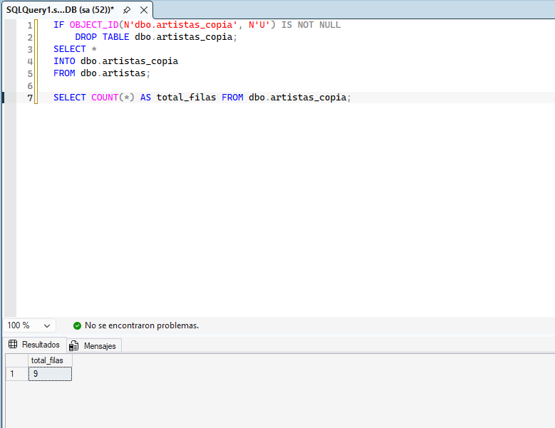
---

### Ejercicio 02
Laura Gil quiere una tabla solo con los usuarios de los mercados de Latinoamérica (México `MX`, Argentina `AR`, Colombia `CO` y Puerto Rico `PR`) para su equipo. Crea la tabla `usuarios_latam` con el identificador, el nombre de usuario, el país y el plan. No incluyas el email ni la fecha de alta. Consulta el resultado ordenado por país y nombre de usuario.

*Salida esperada:* Listado filtrado y ordenado de los usuarios de dichos países.
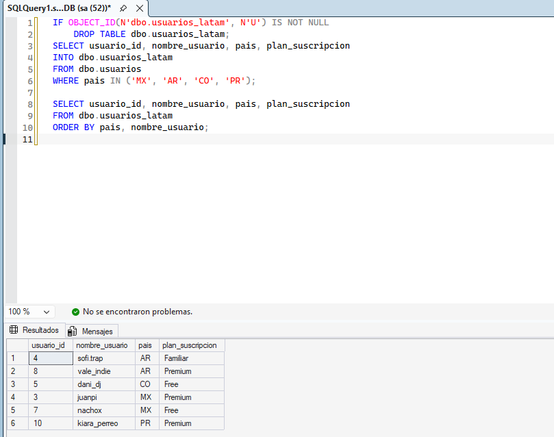
---

### Ejercicio 03
Mañana llega un lote de altas de usuarios. Crea la tabla `stg_usuarios_2309`, vacía y con las mismas columnas que usuarios. Después comprueba que no tiene filas y lista los nombres de sus columnas con `INFORMATION_SCHEMA.COLUMNS`.

*Pregunta teórica:* ¿podrías insertar dos veces una fila con `usuario_id = 1` en `stg_usuarios_2309`? ¿Y una fila con el email a `NULL`?

*Salida esperada:* `(0 rows affected)` al crear la tabla, filas vale `0` y las columnas del esquema.
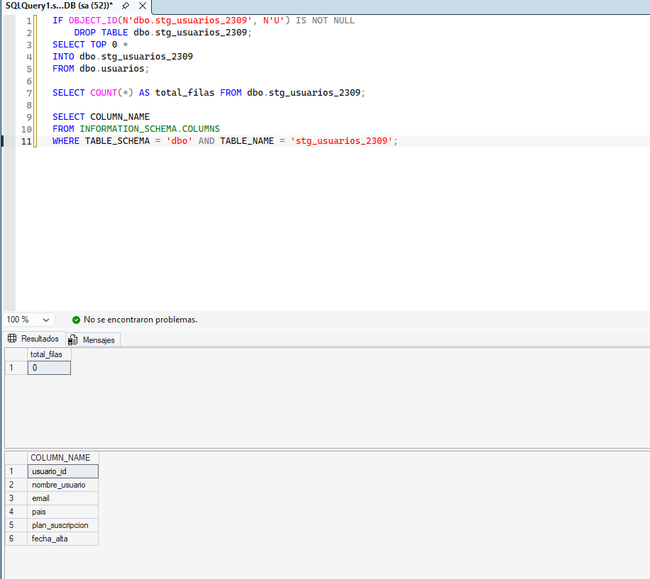
---

### Ejercicio 04
El equipo comercial quiere analizar por separado los anuncios emitidos. Crea la tabla `anuncios_emitidos` con el identificador de la reproducción, el usuario, la fecha y hora y el dispositivo de cada reproducción de tipo Anuncio. Escribe el script de forma que pueda ejecutarse dos veces seguidas sin error y compruébalo. Consulta el resultado ordenado por identificador.

*Salida esperada:* Registros correspondientes a los anuncios ordenados por ID de reproducción.
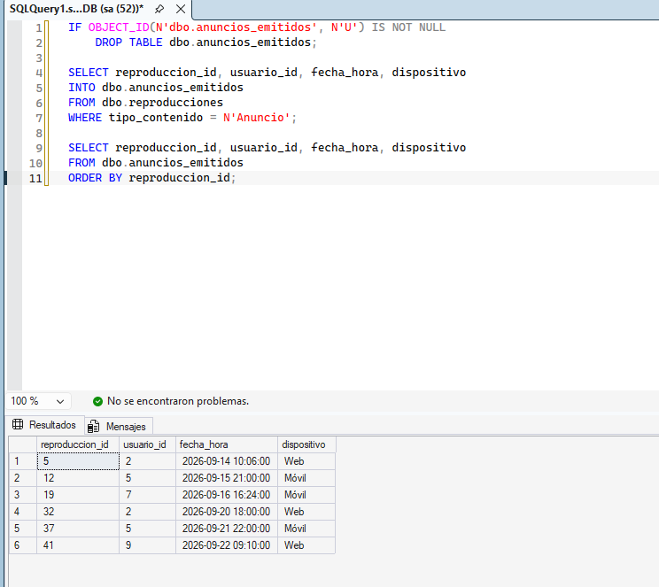
---

### Ejercicio 05
Marketing quiere saber de qué países son los artistas que escucha cada mercado. Un compañero ha escrito un CTAS para cruzar el país del usuario con el país del artista en las reproducciones válidas, pero presenta errores.
Explica los dos problemas que tiene y corrígelo. La tabla debe tener las columnas `pais_usuario`, `pais_artista` y `reproducciones`. Muestra las 5 combinaciones con más reproducciones, desempatando por país del usuario y país del artista.

*Salida esperada:* La tabla tiene 16 filas y las 5 primeras combinaciones ordenadas por mayor número de reproducciones.
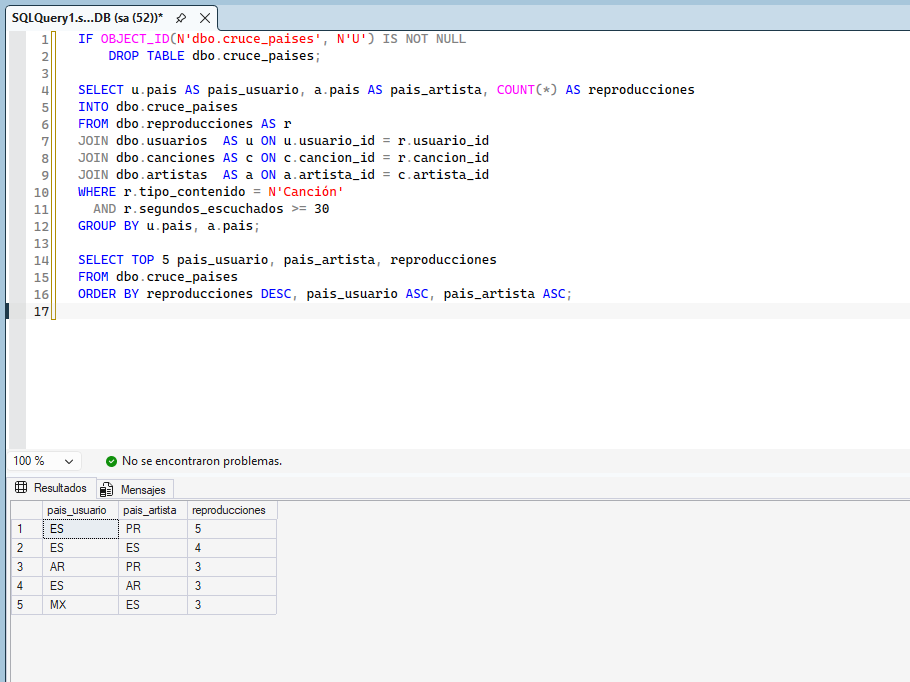
---

### Ejercicio 06
El equipo editorial quiere una ficha de cada canción para preparar playlists por duración. Crea la tabla `canciones_ficha` con:
- `cancion_id` y `titulo`, tal cual.
- `duracion_min`: la duración en minutos con un decimal, de tipo `decimal(4,1)`.
- `categoria`: 'Larga' si dura 300 segundos o más, 'Media' si dura entre 180 y 299, y 'Corta' en el resto de casos. Tipo `nvarchar(10)`.

Comprueba los tipos creados con `INFORMATION_SCHEMA.COLUMNS` y cuenta las canciones de cada categoría.
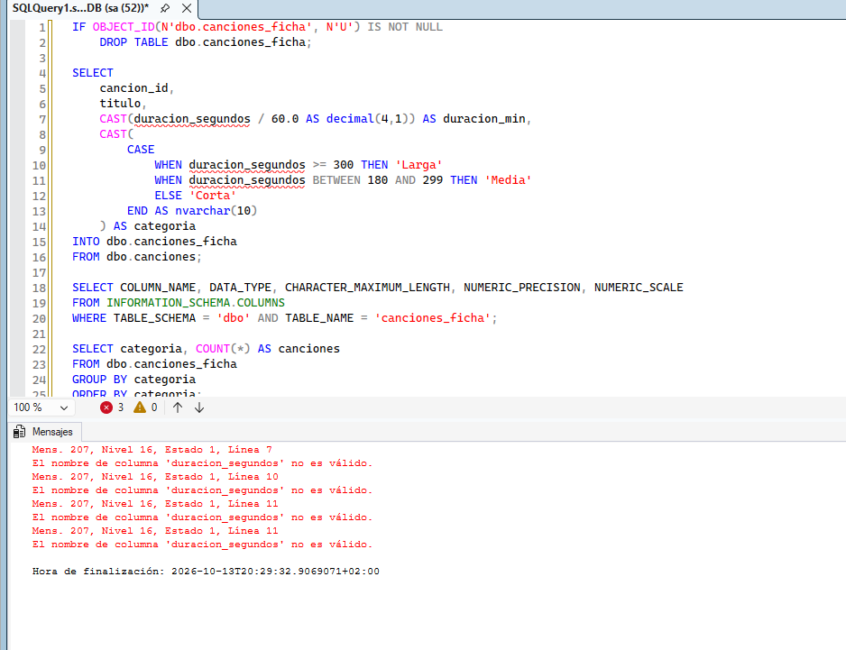
---

### Ejercicio 07
Carmen Lozano va a revisar los lanzamientos recientes antes de proponerlos para portada. Crea la tabla `seguimiento_lanzamientos` con las canciones lanzadas desde el 01/08/2026 (identificador, título y fecha de lanzamiento) y tres columnas de seguimiento:
- `estado`: empieza con el valor 'Sin revisar' (hasta 30 caracteres).
- `revisado_por`: empieza vacía (hasta 100 caracteres).
- `fecha_revision`: empieza vacía (fechas).

Después registra la primera revisión: *Galaxia Dembow* pasa a estado 'Revisado: apta para portada', revisada por Carmen Lozano el 23/09/2026. Consulta la tabla ordenada por fecha de lanzamiento.
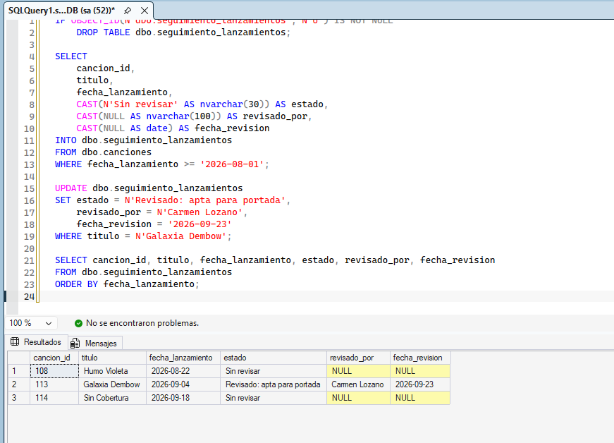
---

### Ejercicio 08
Una distribuidora digital necesita el catálogo de Sonora en una sola tabla, sin identificadores internos de artista ni de género. Crea la tabla `catalogo_completo` con una fila por canción y las columnas `cancion_id`, `titulo`, `artista`, `pais_artista`, `genero` y `genero_padre`. Después, usando solo la tabla nueva, cuenta las canciones por `genero_padre`, de mayor a menor y, en caso de empate, por nombre.
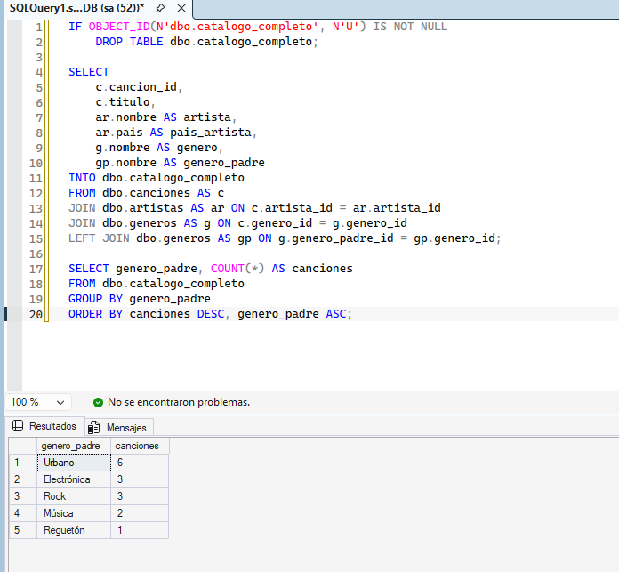
---

### Ejercicio 09
El equipo de producto quiere una tabla con la actividad de cada usuario para segmentar mensajes dentro de la app. Crea la tabla `actividad_usuarios` con una fila por usuario (los 10) y las columnas `usuario_id`, `nombre_usuario`, `plan_suscripcion`, `validas`, `saltos` y `anuncios`. Calcula los tres recuentos en una CTE y crea la tabla a partir de ella. Consulta el resultado ordenado por identificador.
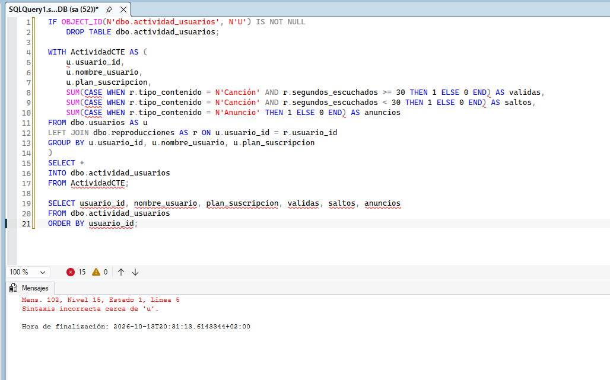
---

### Ejercicio 10
Recursos Humanos consulta el organigrama a menudo y no quiere depender de una consulta recursiva. Con una CTE recursiva sobre empleados, crea la tabla `organigrama_plano` con `empleado_id`, `nombre`, `puesto`, `nivel` (CEO es nivel 0) y `ruta` (formato `Irene Salas > Tomás Vidal > ...`). Después, usando solo la tabla nueva y sin recursión:
a) Cuenta los empleados de cada nivel.
b) Lista, con `LIKE` sobre la ruta, a Raúl Benet y a todas las personas que dependen de él, ordenadas por nivel y nombre.
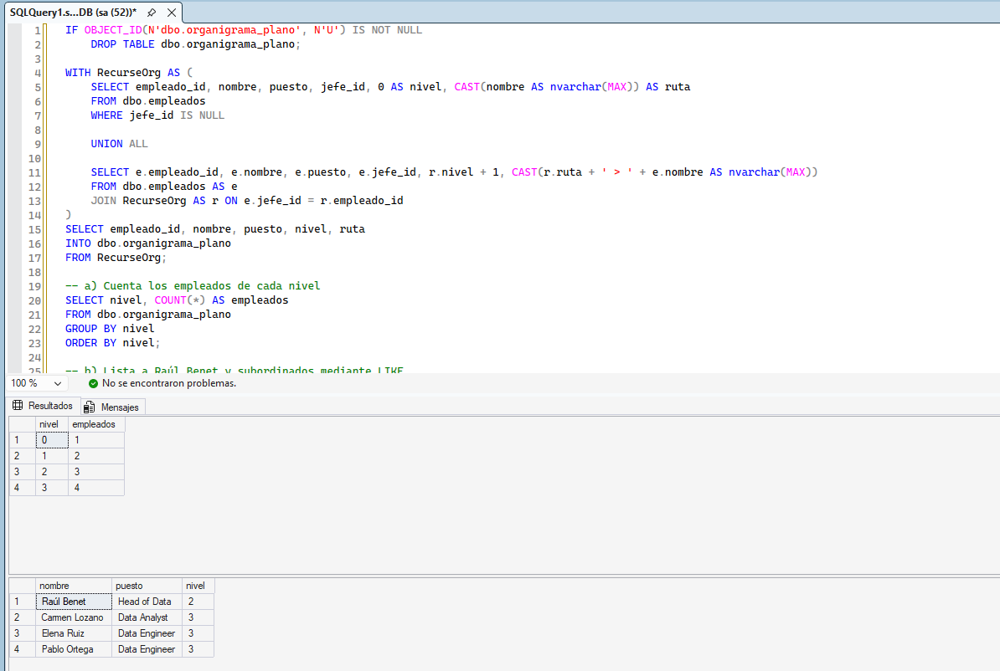
---

### Ejercicio 11
Dirección quiere ver en qué países tiene Sonora presencia, ya sea por usuarios o por artistas. Crea la tabla `personas_por_pais` uniendo con `UNION ALL` los usuarios y los artistas, con tres columnas: `pais`, `tipo` ('Usuario' o 'Artista', tipo `nvarchar(10)`) y `nombre`. Después, usando solo la tabla nueva, obtén por cada país cuántos usuarios y cuántos artistas hay, ordenando por número de usuarios de mayor a menor y por país.
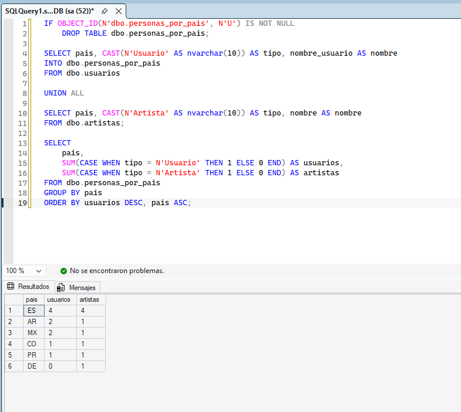
---

### Ejercicio 12
Finanzas cierra hoy el recuento de usuarios por plan y necesita que esa cifra no cambie aunque después haya altas o cambios de plan.
a) Crea la tabla `foto_usuarios_plan` con el plan y el número de usuarios de cada uno.
b) Dentro de una transacción que termine en `ROLLBACK`, pasa a nachox al plan Premium y, antes de deshacer, escribe una consulta que compare la foto con el recuento actual y muestre solo los planes cuya cifra ha cambiado.
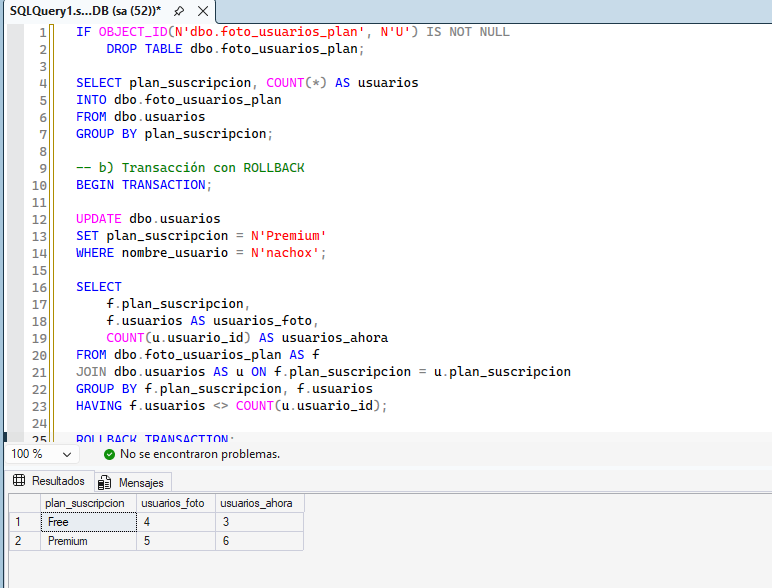
---

# Ejercicios de Tablas Temporales y Lotes en SQL

Este repositorio contiene una serie de ejercicios prácticos sobre el uso de tablas temporales, variables de tabla, lotes y CTEs recursivas en SQL para el equipo de análisis de la plataforma musical Sonora.

## Ejercicio 1
El equipo de relación con sellos va a hacer varias consultas sobre los lanzamientos de este año. Guarda en la tabla temporal `#lanzamientos_2026` las canciones lanzadas en 2026, con su identificador, su título, el nombre del artista y la fecha de lanzamiento. Después, consulta sobre ella cuántos lanzamientos tiene cada artista, ordenados de más a menos y, en caso de empate, por nombre.
**Salida esperada:** `(9 rows affected)` al crear la tabla, y la consulta devuelve:
| artista | lanzamientos |
| :--- | :--- |
| MC Brisa | 3 |
| Nébula | 3 |
| DJ Coral | 1 |
| Los Voltios | 1 |
| Luna Roja | 1 |
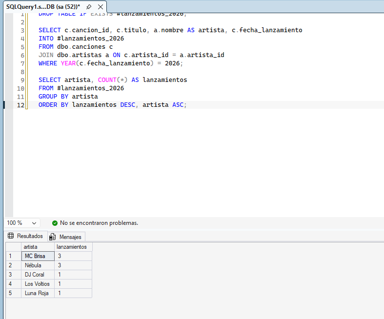
## Ejercicio 2
Finanzas necesita trabajar durante la mañana con la lista de usuarios de pago (planes Premium y Familiar). Crea con `CREATE TABLE` la tabla temporal `#usuarios_pago`, con el identificador como clave primaria, el nombre de usuario, el país y el plan, y llénala con un `INSERT ... SELECT`. Consulta cuántos usuarios de pago hay por país, de más a menos y por país en caso de empate. Por último, ejecuta de nuevo solo el INSERT y explica qué ocurre.
**Salida esperada:** `(6 rows affected)` al llenar la tabla, y la consulta devuelve:
| pais | usuarios_pago |
| :--- | :--- |
| AR | 2 |
| ES | 2 |
| MX | 1 |
| PR | 1 |
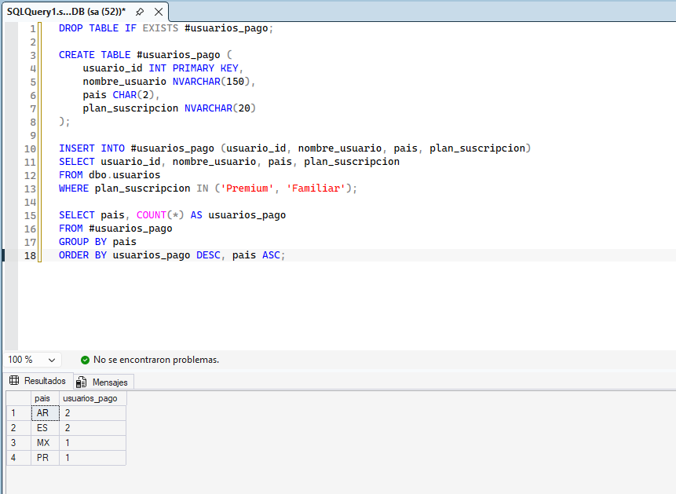
## Ejercicio 3
Hugo Marín ha escrito este script para revisar las canciones de más de cinco minutos. La primera vez funciona y devuelve 4. Cuando lo ejecuta por segunda vez en la misma ventana, falla.
Explica qué error aparece y por qué, y corrige el script para que se pueda ejecutar todas las veces que haga falta. Responde también: si Hugo abre una ventana nueva y ejecuta allí el script original, sin corregir, ¿falla la primera vez?
**Salida esperada del script corregido, en cualquier ejecución:**
| canciones_largas |
| :--- |
| 4 |
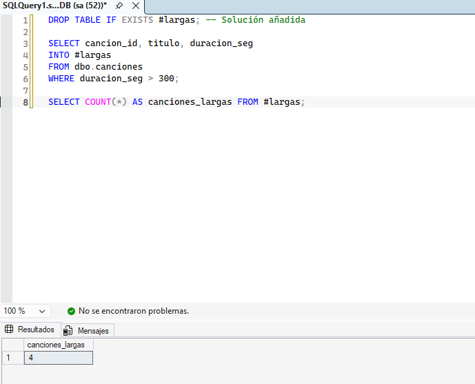
## Ejercicio 4
Sin ejecutarlo, indica qué devuelve cada uno de los tres lotes de este script. Después ejecútalo para comprobarlo.
**Salida esperada:** el primer lote devuelve `a = 2` y `b = 2`. El segundo lote no devuelve ningún resultado, solo un error. El tercer lote devuelve `e = 2`.
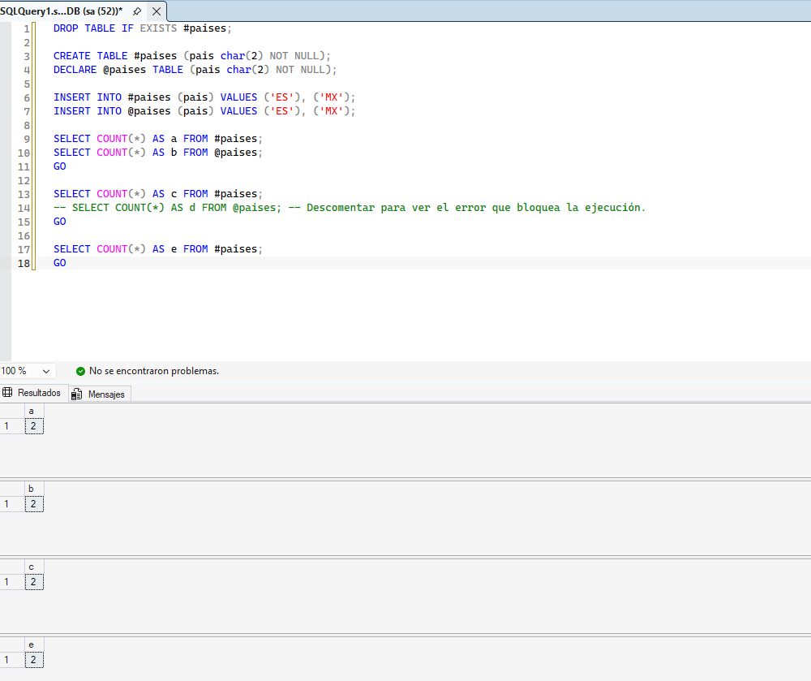
## Ejercicio 5
Carmen va a responder tres preguntas sobre todas las reproducciones válidas del histórico, no solo las de la semana. Guarda esas reproducciones en `#validas` (identificador, usuario, canción, segundos y dispositivo) y responde, usando siempre esa tabla:
a) Reproducciones válidas y minutos (con un decimal) por país del usuario, ordenado por reproducciones de mayor a menor.
b) Títulos de las canciones del catálogo que no tienen ninguna reproducción válida, por orden alfabético.
c) Usuarios que no tienen ninguna reproducción válida, con su plan.
**Salida esperada:** `(32 rows affected)` al crear la tabla.
a) 
| pais | reproducciones | minutos |
| :--- | :--- | :--- |
| ES | 15 | 48.4 |
| MX | 9 | 38.3 |
| AR | 4 | 11.3 |
| CO | 3 | 12.4 |
| PR | 1 | 2.9 |

b)
| titulo |
| :--- |
| Latido |
| Sin Cobertura |

c)
| nombre_usuario | plan_suscripcion |
| :--- | :--- |
| vale_indie | Premium |
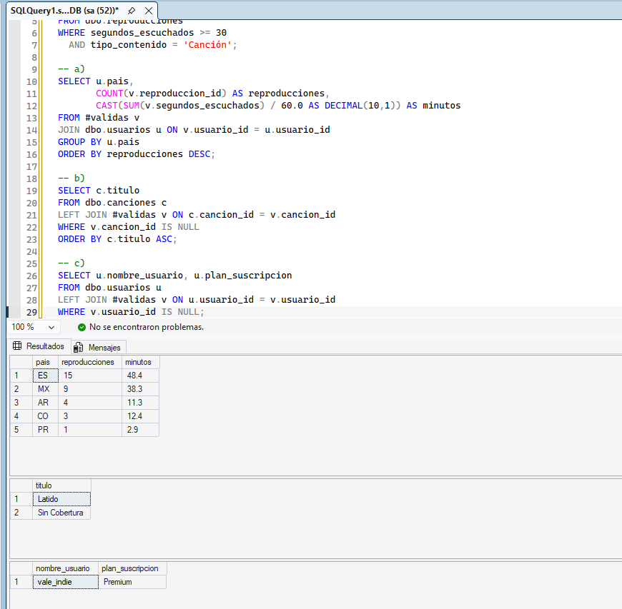
## Ejercicio 6
Finanzas quiere estimar los royalties de la semana de análisis por plan. La tarifa no está en ninguna tabla de Sonora: se pagan 0,08 € por cada minuto válido escuchado por un usuario Premium o Familiar y 0,02 € por cada minuto válido de un usuario Free. Guarda las tarifas en una variable de tabla `@tarifas` y calcula, a partir de `#validas_semana`, los minutos con un decimal, la tarifa y el importe con dos decimales por plan. Ordena por importe de mayor a menor.
**Salida esperada:**
| plan_suscripcion | minutos | euros_minuto | importe |
| :--- | :--- | :--- | :--- |
| Premium | 39.5 | 0.08 | 3.16 |
| Free | 29.3 | 0.02 | 0.59 |
| Familiar | 5.6 | 0.08 | 0.45 |
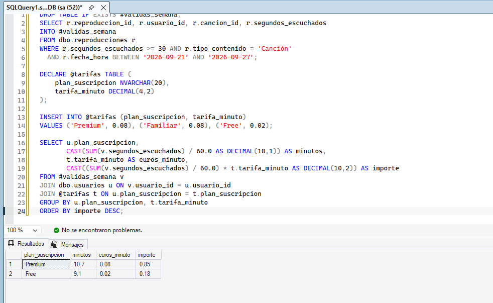
## Ejercicio 7
El equipo editorial quiere clasificar el catálogo por duración para montar playlists, sin modificar la tabla canciones. Copia en `#catalogo` el identificador, el título y la duración de todas las canciones. Añade una columna formato y rellénala: Corta si dura menos de 180 segundos, Estándar si dura entre 180 y 300 (ambos incluidos) y Larga si dura más de 300. Muestra cuántas canciones hay de cada formato. Después borra de `#catalogo` las canciones cortas y comprueba cuántas filas quedan.
**Salida esperada:**
| formato | canciones |
| :--- | :--- |
| Estándar | 7 |
| Corta | 4 |
| Larga | 4 |
Tras el borrado:
| filas_catalogo_temporal | filas_canciones |
| :--- | :--- |
| 11 | 15 |
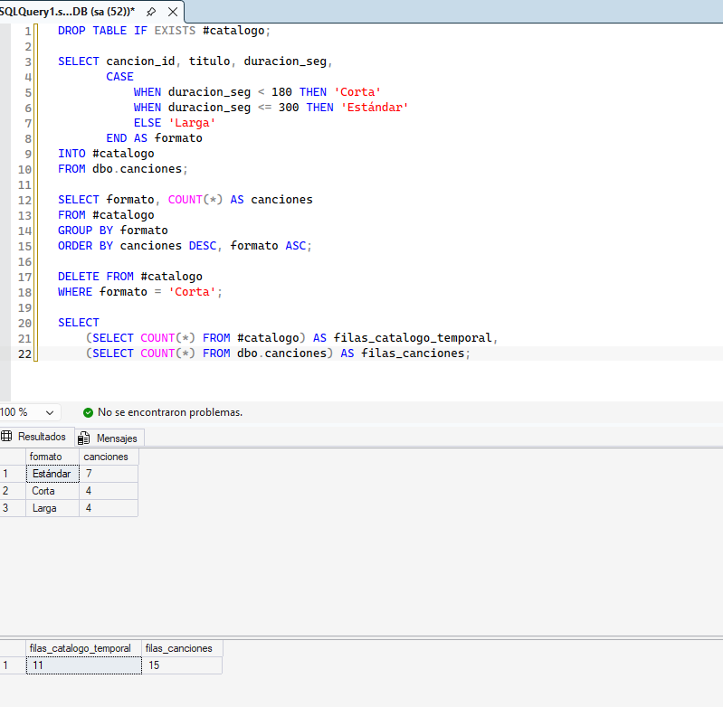
## Ejercicio 8
Nuria Campos quiere revisar las cifras por artista de la semana de análisis. Publica en una tabla temporal global `##artistas_semana` el nombre de cada artista, sus reproducciones válidas de la semana y sus minutos con un decimal. Después abre una segunda ventana de consulta y muestra solo los artistas con más de una reproducción.
Responde además: a) ¿Qué le ocurre a la consulta de Nuria si cierras la primera ventana? b) ¿Por qué no sería buena idea incluir en esta tabla el email de los oyentes?
**Salida esperada:** `(8 rows affected)` al crear la tabla.
| artista | reproducciones | minutos |
| :--- | :--- | :--- |
| MC Brisa | 9 | 26.0 |
| Los Voltios | 4 | 14.4 |
| Luna Roja | 3 | 9.5 |
| Verso Libre | 2 | 7.1 |
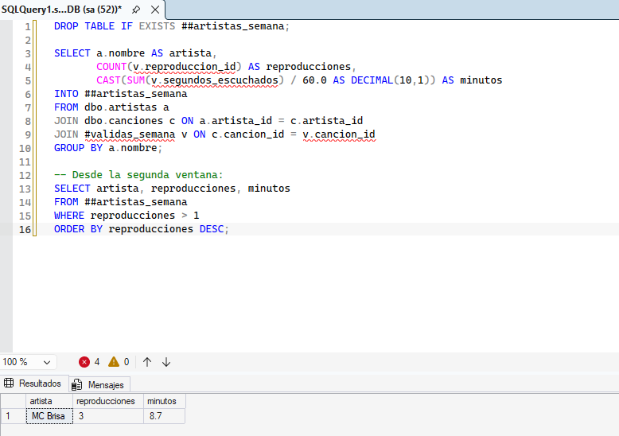
## Ejercicio 9
Finanzas está simulando una subida de precio del plan Premium. Sin ejecutarlo, indica qué devuelven las dos consultas finales de un script con una transacción de rollback sobre una tabla y una variable temporal. 
**Salida esperada:**
| plan_suscripcion | precio_mes |
| :--- | :--- |
| Familiar | 17.99 |
| Premium | 10.99 |

| plan_suscripcion | precio_nuevo |
| :--- | :--- |
| Premium | 11.99 |
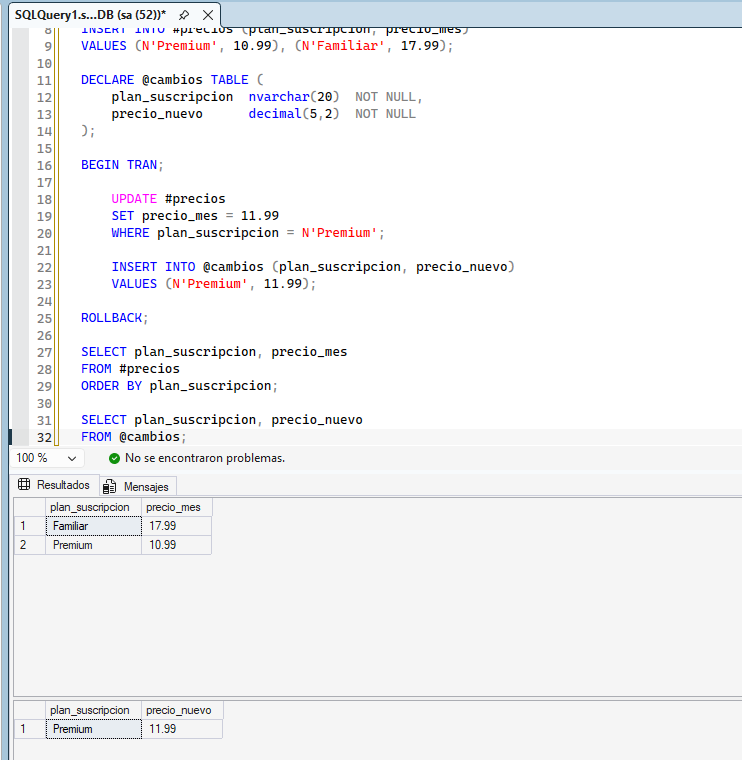
## Ejercicio 10
Calcula el árbol de géneros una sola vez y guárdalo en `#arbol_generos`, con el identificador de cada género y el nombre de su género principal usando una CTE recursiva. Después responde:
a) ¿Cuántas canciones del catálogo hay en cada género principal?
b) ¿Cuántas reproducciones válidas y minutos tiene cada género principal?
**Salida esperada:** `(12 rows affected)` al crear la tabla.
a)
| genero_principal | canciones |
| :--- | :--- |
| Urbano | 7 |
| Electrónica | 3 |
| Rock | 3 |
| Pop | 2 |

b)
| genero_principal | reproducciones | minutos |
| :--- | :--- | :--- |
| Urbano | 17 | 50.5 |
| Rock | 7 | 25.4 |
| Electrónica | 5 | 28.0 |
| Pop | 3 | 9.5 |
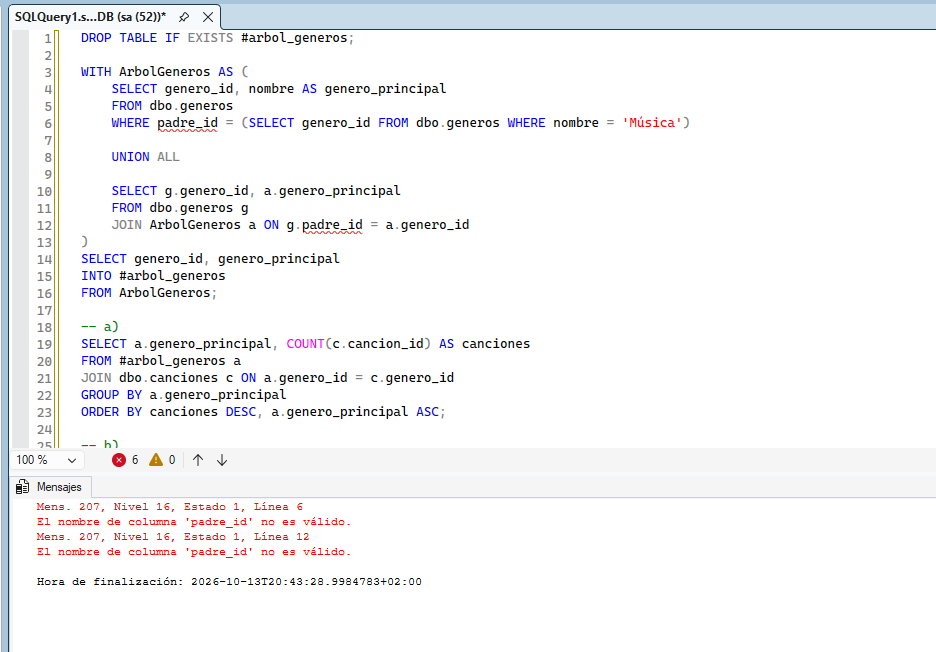
## Ejercicio 11
Los sellos han enviado el lote de novedades en `dbo.stg_canciones_2509`. Aterriza el lote en la tabla temporal `#novedades` sin duplicados exactos, comprueba que no queda ningún `cancion_id` repetido y descarta las canciones que ya existen en el catálogo.
**Salida esperada:** `(6 rows affected)` al aterrizar, `0` filas en la comprobación y `(1 row affected)` al descartar. Quedan:
| cancion_id | titulo | artista_id | duracion_seg |
| :--- | :--- | :--- | :--- |
| 116 | Órbita | 9 | 192 |
| 117 | Asfalto Mojado | 8 | 221 |
| 118 | Voltaje | 4 | 0 |
| 119 | Bruma | 15 | 240 |
| 120 | Cumbia Digital | 7 | 263 |
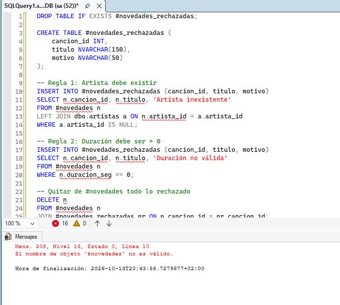

